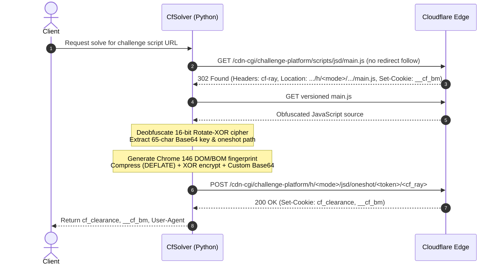

# Cloudflare Invisible Challenge Solver (JSD / Oneshot)

[](https://www.python.org/)
[](https://github.com/lexiforest/curl_cffi)
[](https://flask.palletsprojects.com/)
[](#benchmarks--speed)
[](LICENSE)

A high-performance, browserless solver for **Cloudflare Invisible Challenges** (`jsd` / `oneshot`). Solves challenges in **~1–2 seconds** using pure HTTP requests, modern Chrome 146 TLS impersonation, and runtime deobfuscation of Cloudflare's 16-bit rotate-XOR cipher.

Provides a **Python library**, a **REST API**, and an **interactive Web Dashboard**.

> **Note**: Originally forked from [notemrovsky/cloudflare-invisible-solver](https://github.com/notemrovsky/cloudflare-invisible-solver). This enhanced version features dynamic cipher deobfuscation for modern Cloudflare scripts, multi-mode endpoint routing (`h/g` and `h/b`), dual-phase `__cf_bm` extraction, an interactive web interface, and stateless API server execution.

---

## Table of Contents

- [Key Features](#key-features)
- [How It Works](#how-it-works)
  - [Sequence Flow](#sequence-flow)
  - [Technical Breakdown](#technical-breakdown)
- [Project Structure](#project-structure)
- [Installation](#installation)
- [Quick Start & Usage](#quick-start--usage)
  - [1. Interactive Web Dashboard](#1-interactive-web-dashboard)
  - [2. REST API Server](#2-rest-api-server)
  - [3. Python Module](#3-python-module)
  - [4. Scraping Protected Sites (End-to-End Example)](#4-scraping-protected-sites-end-to-end-example)
- [Proxy Configuration](#proxy-configuration)
- [Deep Dive: Cryptography & Obfuscation](#deep-dive-cryptography--obfuscation)
  - [Dynamic String Deobfuscation (16-bit Rotate-XOR)](#dynamic-string-deobfuscation-16-bit-rotate-xor)
  - [Payload Encoding Pipeline](#payload-encoding-pipeline)
- [Critical Requirements & Caveats](#critical-requirements--caveats)
- [Compatibility & Supported Challenges](#compatibility--supported-challenges)
- [Troubleshooting](#troubleshooting)
- [Educational Disclaimer](#educational-disclaimer)

---

## Key Features

- **⚡ Blazing Fast (~1–2s Solve Time)**: No Playwright, Puppeteer, Selenium, or headless Chromium overhead. Operates entirely over raw HTTP requests.
- **🔓 Dynamic JS Cipher Deobfuscation**: Automatically reverse-engineers Cloudflare's 16-bit rotate-XOR string cipher at runtime to extract dynamic encryption keys and endpoint tokens.
- **🛡️ Chrome 146 TLS Impersonation**: Uses `curl_cffi` to match Chrome 146 JA3/JA4 fingerprints, ALPN negotiation, and HTTP/2 settings.
- **🌐 Dual-Mode Support**: Dynamically handles both `/challenge-platform/h/g/` and `/challenge-platform/h/b/` challenge paths.
- **🍪 Full Cookie Extraction**: Captures both `cf_clearance` and `__cf_bm` (Cloudflare Bot Management) cookies across redirect and challenge POST stages.
- **🖥️ Built-in Web UI**: Sleek, modern dark-mode dashboard for testing challenges directly in your browser with one-click token copying.
- **🚀 Production-Ready REST API**: Stateless Flask server supporting URL parameters and proxy pools.

---

## How It Works

### Sequence Flow



### Technical Breakdown

1. **Challenge Discovery (HTTP 302 Handshake)**:
   The solver sends a `GET` request to the target site's challenge script endpoint (`/cdn-cgi/challenge-platform/scripts/jsd/main.js`) with redirection disabled. It extracts:
   - The Cloudflare Ray ID (`cf-ray` header).
   - The deployment path from the `Location` header.
   - The challenge platform mode (`h/g` or `h/b`).
   - The initial `__cf_bm` cookie (if set during the handshake).

2. **Dynamic Script Reverse-Engineering**:
   The versioned `main.js` contains heavily obfuscated strings encrypted using a custom 16-bit rotate-XOR cipher. Rather than relying on fragile hardcoded regexes, the solver:
   - Identifies the decoder function signature and runtime seed integer.
   - Decrypts all obfuscated string calls in the script.
   - Extracts the custom 65-character Base64 alphabet (`enc_key`) and the dynamic oneshot route (`oneshot_path`).

3. **Browser Fingerprint Generation**:
   Constructs a realistic Chrome 146 browser state (`utils/fingerprint.py`) covering navigator properties (`hardwareConcurrency`, `deviceMemory`, `maxTouchPoints`, `vendor`), document attributes, screen metrics, and document prototypes.

4. **Multi-Stage Payload Encryption**:
   The fingerprint payload is serialized and passed through Cloudflare's exact encoding pipeline (`utils/encryption.py`):
   - Raw DEFLATE compression (level 1, window bits `-15`).
   - 3-byte header injection (`[0xFD, 0x01, compression_flag]`).
   - XOR encryption seeded with an FNV-1a hash and `xorshift32` PRNG.
   - Custom Base64 encoding using the 65-character alphabet extracted from step 2.

5. **Token Harvest (HTTP POST)**:
   Sends the encrypted payload to `{domain}/cdn-cgi/challenge-platform/h/{mode}{oneshot_path}{cf_ray}` with Chrome 146 request headers. Cloudflare responds with `200 OK` and issues the `cf_clearance` cookie.

---

## Project Structure

```
cloudflare-invisible-solver/
├── main.py              # Core solver class (CfSolver) and JS deobfuscation logic
├── server.py            # Flask REST API server and static web UI host
├── requirements.txt     # Python runtime dependencies
├── README.md            # Project documentation
├── static/              # Interactive Web UI assets
│   ├── index.html       # Dashboard HTML structure
│   ├── style.css        # Modern dark-mode UI styling
│   └── app.js           # Client-side challenge solver controller
└── utils/
    ├── __init__.py
    ├── constants.py     # Chrome 146 default and challenge headers
    ├── encryption.py    # Compression, FNV-1a, XOR, and custom Base64 encoder
    └── fingerprint.py   # Synthesizes realistic Chrome 146 DOM/BOM fingerprint
```

---

## Installation

### Prerequisites

- Python 3.10 or higher
- `git`

### Setup

1. **Clone the repository**:
   ```bash
   git clone https://github.com/your-username/cloudflare-invisible-solver.git
   cd cloudflare-invisible-solver
   ```

2. **Create and activate a virtual environment**:
   ```bash
   python3 -m venv venv
   source venv/bin/activate  # On Windows: venv\Scripts\activate
   ```

3. **Install dependencies**:
   ```bash
   pip install -r requirements.txt
   ```

> [!TIP]
> `curl_cffi` bundles precompiled `libcurl-impersonate` binaries. No external system packages or browser installations are required.

---

## Quick Start & Usage

### 1. Interactive Web Dashboard

Start the Flask application:

```bash
python3 server.py
```

Open [http://localhost:5000](http://localhost:5000) in your browser.

- Enter the target challenge script URL (e.g., `https://discord.com/cdn-cgi/challenge-platform/scripts/jsd/main.js`).
- (Optional) Enter proxy endpoints.
- Click **Solve Challenge** or press <kbd>Enter</kbd>.
- Copy the generated `cf_clearance`, `__cf_bm`, or exact `User-Agent` with a single click.

---

### 2. REST API Server

With `server.py` running, send a `GET` request to `/solve`:

#### Request

```bash
curl -X GET "http://localhost:5000/solve?url=https://discord.com/cdn-cgi/challenge-platform/scripts/jsd/main.js"
```

With proxies:
```bash
curl -X GET "http://localhost:5000/solve?url=https://discord.com/cdn-cgi/challenge-platform/scripts/jsd/main.js&proxies=http://127.0.0.1:8080,http://127.0.0.1:8081"
```

#### Success Response (`HTTP 200`)

```json
{
  "success": true,
  "cf_clearance": "W2ajRu5cqT5bkho9KJ4nUISibDwNhP5jVc5hY9R9S7k-1793241918-1.2.1.1-VT8v...",
  "__cf_bm": "CM3WBMw2iwuf7.s2NybSTjttGUs...",
  "user_agent": "Mozilla/5.0 (Windows NT 10.0; Win64; x64) AppleWebKit/537.36 (KHTML, like Gecko) Chrome/146.0.0.0 Safari/537.36"
}
```

#### Error Response (`HTTP 400` / `HTTP 500`)

```json
{
  "success": false,
  "error": "Could not extract encryption key from main.js"
}
```

---

### 3. Python Module

You can import and integrate the solver directly into your Python scripts:

#### Basic Usage (`CfSolver`)

```python
from main import CfSolver

solver = CfSolver()
challenge_url = "https://discord.com/cdn-cgi/challenge-platform/scripts/jsd/main.js"

cf_clearance = solver.get_solution(challenge_url)

if cf_clearance:
    print(f"Solved! cf_clearance: {cf_clearance}")
else:
    print("Failed to solve challenge.")
```

#### Extended Usage (`CfSolverAPI`)

If you need the complete token bundle (`cf_clearance`, `__cf_bm`, and matched `user_agent`):

```python
from server import CfSolverAPI

solver = CfSolverAPI(proxies=["127.0.0.1:8080"])
result = solver.get_solution_full(
    "https://discord.com/cdn-cgi/challenge-platform/scripts/jsd/main.js"
)

if result["success"]:
    print(f"cf_clearance: {result['cf_clearance']}")
    print(f"__cf_bm:      {result['__cf_bm']}")
    print(f"user_agent:   {result['user_agent']}")
else:
    print(f"Error: {result['error']}")
```

---

### 4. Scraping Protected Sites (End-to-End Example)

> [!IMPORTANT]
> **User-Agent & TLS Consistency**: Cloudflare binds the `cf_clearance` cookie to the exact **User-Agent** and **TLS profile** used during solving. You must make downstream requests with matching parameters.

Here is a complete example demonstrating how to solve the challenge and use the clearance cookie to fetch protected content:

```python
from curl_cffi import requests
from server import CfSolverAPI

TARGET_DOMAIN = "https://discord.com"
CHALLENGE_URL = f"{TARGET_DOMAIN}/cdn-cgi/challenge-platform/scripts/jsd/main.js"

# Step 1: Solve the challenge
solver = CfSolverAPI()
solution = solver.get_solution_full(CHALLENGE_URL)

if not solution.get("success"):
    raise RuntimeError(f"Solver failed: {solution.get('error')}")

print("[✓] Challenge solved successfully!")
cf_clearance = solution["cf_clearance"]
cf_bm = solution["__cf_bm"]
user_agent = solution["user_agent"]

# Step 2: Configure a scraper session matching the solver's profile
session = requests.Session(impersonate="chrome146")
session.headers.update({
    "user-agent": user_agent,
    "accept": "text/html,application/xhtml+xml,application/xml;q=0.9,image/avif,image/webp,*/*;q=0.8",
    "accept-language": "en-US,en;q=0.9",
})

# Step 3: Inject the solved cookies
session.cookies.set("cf_clearance", cf_clearance, domain=f".{TARGET_DOMAIN.split('//')[1]}")
if cf_bm:
    session.cookies.set("__cf_bm", cf_bm, domain=f".{TARGET_DOMAIN.split('//')[1]}")

# Step 4: Access protected endpoints
response = session.get(TARGET_DOMAIN)
print(f"HTTP Status: {response.status_code}")
print(f"Page Title or Length: {len(response.text)} bytes")
```

---

## Proxy Configuration

The solver supports standard HTTP and HTTPS proxies. When multiple proxies are provided, the solver randomly chooses an endpoint per request:

```python
solver = CfSolver(proxies=[
    "user:pass@111.222.333.444:8080",
    "user:pass@555.666.777.888:8080",
])
```

> [!WARNING]
> **IP Binding**: Cloudflare binds `cf_clearance` cookies to the solver's egress IP. If you solve using proxy `A`, downstream scraping requests must also route through proxy `A`. Rotating to a new IP on subsequent requests will invalidate clearance.

---

## Deep Dive: Cryptography & Obfuscation

### Dynamic String Deobfuscation (16-bit Rotate-XOR)

Cloudflare obfuscates strings in `main.js` via a compact cipher function:
1. Strings are base64-decoded into raw bytes.
2. An internal 16-bit state register `T` is initialized with a runtime seed extracted from the code.
3. For each byte, `T` undergoes an 8-bit rotation:
   $$\ T = ((T \ll 8) \mid (T \gg 8)) \ \& \ \text{0xFFFF} $$
4. Bytes are decrypted via $y = \text{data}[F] \oplus (T \gg 8)$. When $y = 255$, an escape sequence reconstructs wide characters.
5. `_decode_cf_strings` evaluates all cipher invocations dynamically to reliably locate:
   - The 65-character alphabet (`/^[a-zA-Z0-9+\-$]{65}$/`).
   - The `/jsd/oneshot/` path structure.

### Payload Encoding Pipeline

The generated fingerprint is encoded through a 5-step pipeline:

$$\text{Dict} \xrightarrow{\text{JSON}} \text{UTF-8} \xrightarrow[\ge 128\text{ B}]{\text{DEFLATE}} \text{Header [0xFD, 0x01, Flag]} \xrightarrow[\text{xorshift32}]{\text{XOR}} \text{Custom Base64}$$

- **DEFLATE**: Headerless raw deflate (`wbits=-15`, `level=1`, `memLevel=9`).
- **PRNG**: Seeded using an FNV-1a 32-bit hash of the encryption key, iterated through `xorshift32`:
  $$x \leftarrow x \oplus (x \ll 13), \quad x \leftarrow x \oplus (x \gg 17), \quad x \leftarrow x \oplus (x \ll 5)$$
- **Custom Base64**: Uses 6 bits per character mapped directly to the extracted 65-character alphabet.

---

## Critical Requirements & Caveats

1. **User-Agent Lock**: Cloudflare strictly validates that the HTTP client User-Agent matches the one declared in the challenge payload. If you use a different User-Agent, requests will immediately receive `403 Forbidden`.
2. **`__cf_bm` Cookie Presence**: Some sites set `__cf_bm` alongside `cf_clearance`, while others only issue `cf_clearance`. The solver automatically populates `__cf_bm` if present or defaults to an empty string.
3. **URL Format**: The solver expects the full URL to the Cloudflare challenge script:
   ```
   https://<domain>/cdn-cgi/challenge-platform/scripts/jsd/main.js
   ```

---

## Compatibility & Supported Challenges

| Challenge Type | Supported? | Details |
|---|:---:|---|
| **Cloudflare Invisible Challenge (`jsd` / `oneshot`)** | **Yes** | Fully supported without browser automation (~1–2s). |
| **Cloudflare Managed Turnstile (`cType: 'managed'`)** | **No** | Requires interactive widget solving / token generation. |
| **reCAPTCHA / hCaptcha / Geetest** | **No** | Not supported. |
| **Multi-Stage MFA / Bot Logins** | **Partial** | Solves initial clearance; additional site-level tokens (e.g. login POST tokens) must be handled separately. |

### Tested Domains
- `discord.com` — Functional
- `stockx.com` — Functional
- `5sim.net` — Functional
- `acehardware.com` — Homepage invisible challenge functional (Note: login uses managed Turnstile widget)

---

## Troubleshooting

| Issue | Cause | Solution |
|---|---|---|
| **`Missing cf-ray header`** | The target URL did not respond with a Cloudflare challenge redirect. | Verify the domain is behind Cloudflare and serves `/cdn-cgi/challenge-platform/scripts/jsd/main.js`. |
| **`Could not extract encryption key`** | Cloudflare script structure changed or an unsupported challenge script was provided. | Verify the target script is an invisible `jsd` script. |
| **`POST returned status 403`** | Cloudflare rejected the fingerprint or TLS impersonation. | Ensure `curl_cffi` is properly installed with Chrome 146 support. Check if the site upgraded to managed challenge. |
| **Clearance cookie rejected on target site** | User-Agent mismatch or proxy IP divergence between solver and scraper. | Use the exact `user_agent` returned by the solver and route requests through the same proxy IP. |

---

## Educational Disclaimer

⚠️ **For educational, research, and security evaluation purposes only.** This repository is provided to demonstrate the mechanics of browser fingerprint verification and challenge protocol reversing. Do not use this tool to bypass access controls on systems or websites without explicit authorization from the owner. Users are responsible for complying with all applicable laws and terms of service.
